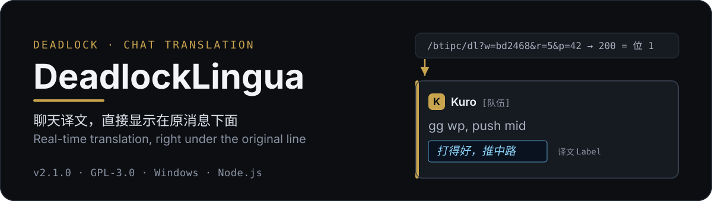
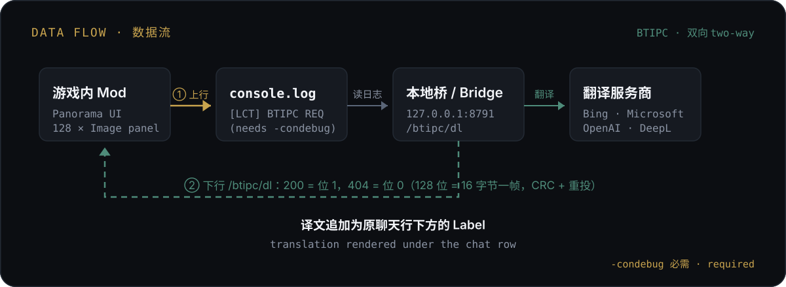

# DeadlockLingua

<p align="center">
  
</p>

<div align="center"></div>

<p align="center">
🇨🇳 <a href="./README.md">简体中文</a> | 🇺🇸 <a href="./README_EN.md">English</a>
</p>

> 《Deadlock》聊天实时翻译工具，基于 [BabelTower](https://github.com/c1375rick/BabelTower) 二次开发，由 [Thirt927](https://github.com/Thirt927) 维护。

把《Deadlock》里队友和对手的外语聊天实时翻译成中文，**译文直接显示在原消息下面**——不用切出游戏、不用看第二个窗口。

<details>
<summary>v2.0.x 的悬浮窗方案还在吗？</summary>

在。v2.0.0（游戏移除 Panorama HTTP 能力后）曾把译文整体搬到**游戏外悬浮窗**，那是当时的过渡方案；从 **v2.1.0** 起译文重新回到游戏内，悬浮窗代码保留在仓库中作为备选（`core/overlay.js`、`scripts/overlay_window.ps1`）。

</details>

---

## 目录

- [它是怎么做到游戏内显示的](#它是怎么做到游戏内显示的)
- [功能](#功能)
- [安装](#安装)
- [使用](#使用)
- [API 参考](#api-参考)
- [配置](#配置)
- [术语表](#术语表)
- [聊天日志与 SteamID](#聊天日志与-steamid)
- [从源码构建](#从源码构建)
- [测试](#测试)
- [发布打包](#发布打包)
- [目录结构](#目录结构)
- [工作原理](#工作原理)
- [常见问题](#常见问题)
- [贡献](#贡献)
- [许可证](#许可证)

---

<p align="center">
  
</p>

## 它是怎么做到游戏内显示的

《Deadlock》2026-10-01 的更新移除了 Panorama 的 HTTP 能力（`$.AsyncWebRequest` 调用即抛，隐藏 HTML 面板也不再创建浏览器实例），所以「游戏里发不出请求」是真的。

但**入站仍然可能**——引擎会为「它自己要去渲染的东西」主动取网络，而游戏并没有移除图片加载：

| 桥返回 | 游戏侧观察到的现象 | 记作 |
|---|---|---|
| `200` + PNG | `ImageLoaded` 事件触发 | **位 1** |
| `404` 空体 | 事件静默 | **位 0** |

游戏侧建 **128 个隐藏 2×2 Image 面板**，每轮把 128 个位一次性问一遍，就是 16 字节一帧；带上 CRC + 重投，端到端约 2～6 秒拿到一条译文。这套双向信道叫 **BTIPC**，规格见 [`docs/btipc-v1.md`](docs/btipc-v1.md)。

> [!NOTE]
> 这条路成立的关键是：图片加载由**引擎在渲染管线里**自行发起，不走 Panorama 的 JS HTTP API，所以 `AsyncWebRequest` 被移除并不影响它。

---

## 功能

**看别人说什么**

- **译文直接显示在原消息下面**（游戏内聊天行），不需要第二个窗口
- HUD 顶栏气泡与大厅聊天记录同样支持
- 已是中文的消息不重复翻译；纯数字/符号、`/` 开头的指令跳过

**说你想说的话**

- **发送前翻译**：输入中文 → 回车 → 先译成英文，再走原版发送链路发出（译文 / 原文|译文 双语模式可选）

**翻译服务**

- 多服务商：Bing（免 Key）、Microsoft、OpenAI 兼容（如 DeepSeek）、DeepL、Google Cloud
- 主服务商超时或失败时**自动回退**到备用服务商
- 内置**游戏术语表**：46 个可玩英雄、194 件商店装备、常用战术术语，译名统一
- **自适应词典**：高频短句自动固化，秒回不再走服务商

**其他**

- 聊天日志按对局 ID 写入 JSONL，便于赛后复盘
- SteamID 回填：聊天昵称自动补全 SteamID64
- 游戏外悬浮窗（v2.0.x 的显示方式）仍保留可用，可在设置里切换

---

<p align="center">
  
</p>

## 安装

下载最新版：`https://github.com/Thirt927/DeadlockLingua/releases/latest`

1. 解压 `DeadlockLingua-<版本>-win64.zip` 到**无空格、无中文**的路径，例如 `D:\DeadlockLingua`。

2. **给 Deadlock 加 `-condebug` 启动参数**（**必做**，只需设置一次）

   游戏不带它就不会写 `game/citadel/console.log`，而那是游戏把请求送出来、也是桥把日志读回去的**唯一上行通路**。缺了它，mod 会表现为「装了完全没反应」。

   Steam 库 → Deadlock 右键 → 属性 → 常规 → **启动选项**，填：

   ```text
   -condebug
   ```

3. **把 Mod 放进游戏**
   - 压缩包内的 VPK 叫 `pak01_dir.vpk`，**先给它改个名字**：只要在 addons 里不重名就行，推荐 `pak22_dir.vpk`（数字随意，22 只是本项目用的空位号）。
   - ⚠️ **不要直接用 `pak01_dir.vpk` 这个名字**：`pak01` 是游戏本体占用的，同名会冲突；另外**千万不要放到 `citadel\` 目录下**（那会覆盖游戏本体资源），只能放 `citadel\addons\`。
   - 推荐用 **Deadlock Mod Manager** 导入；或手动复制到：
     `<Steam 库>\steamapps\common\Deadlock\game\citadel\addons\`
4. **启动本地桥**（二选一）
   - 双击 `install-autostart.bat` 装成开机自启（推荐）
   - 或双击 `StartBridgeSilent.vbs` 临时后台启动
5. **重启 Deadlock**

> [!TIP]
> 用 `StartDeadlock.bat` 启动会自动带上 `-condebug`（`steam://run/.../-condebug`），可以省掉第 2 步。

---

<p align="center">
  
</p>

## 使用

### 看译文

进对局就行——别人说外语，译文会**直接出现在那条消息下面**（浅蓝底、斜体）。

- 译一条约 **2～6 秒**（位信道有效带宽约 16 字节/秒，这是目前通道的物理上限）
- 聊天滚动回收后，译文会从缓存自动重建

如果游戏内一直不出现译文，按顺序检查：

1. 启动选项里有没有 `-condebug`（最常见的原因）
2. 桥在不在跑：浏览器打开 `http://127.0.0.1:8791/api/v1/health`，能看到 JSON 即正常
3. `logs/bridge.log` 里有没有 `BTIPC TRQ` / `BTIPC: r=.. seq=.. OK` 这类行

### 发消息

输入框里打中文，按回车即可——发送前会自动译成英文再发出。想关掉或改成双语，见[设置](#设置)。

### 设置

设置有两个入口：

| 入口 | 怎么用 | 管什么 |
|---|---|---|
| **游戏内** | 输入 `/tr`，或点聊天输入框右侧的「译」按钮（ESC 关闭） | 常用开关：启用翻译、显示模式、**发送前翻译**、目标语言、出站目标语言、超时、自己的发言是否翻译 |
| **网页设置页** | 浏览器打开 `http://127.0.0.1:8791/settings` | 服务商、API Key、端点、回退链、聊天日志、悬浮窗、端口等全部字段 |

> [!NOTE]
> 为什么分两处：游戏内的双向信道是**窄带**的（一帧只有 10 字节载荷，协议上限 128 帧 ≈ 1280 字节），而整份配置约 1.3 KB —— 放不下。所以游戏内面板只管常用的几个开关（直接读内存，打开是秒开的），服务商与 Key 这类一次性配置放网页页。

配置保存在 `config/config.json`，首次运行自动生成。该文件含 API Key，已被 `.gitignore` 忽略，**不要提交到 Git**。

> [!IMPORTANT]
> 设置改完点「保存」后，**下一条消息**即按新设置执行；出站翻译的改动立即生效。

### 启动 / 停止桥

| 操作 | 方式 |
|---|---|
| 后台启动 | `StartBridgeSilent.vbs` |
| 终端启动（可看日志） | `StartDeadlock.bat` |
| 停止 | `StopBridge.bat` |
| 重启 | `RestartBridge.bat` |
| 安装/卸载开机自启 | `install-autostart.bat` / `remove-autostart.bat` |

---

## API 参考

本地桥只监听 `127.0.0.1:8791`，不对外暴露，也不提供任意 URL 代理。请求体上限 64 KB，单条文本上限 4000 字符。

| 方法 | 端点 | 说明 |
|---|---|---|
| `GET` | `/btipc/dl` | **游戏侧位信道下行**。按 `w`(窗口) + `r`(轮号) 取帧：位=1 返回 `200` + PNG，位=0 返回 `404`。游戏侧 128 个 Image 面板各自读回自己那一位 |
| `POST` / `GET` | `/api/v1/translate` | 翻译一段文本，返回 `{ ok, translation, detectedLanguage }` |
| `POST` / `GET` | `/api/v1/test` | 用当前配置测试服务商连通性 |
| `GET` | `/api/v1/health` | 健康检查，返回版本、当前服务商与回退链 |
| `GET` / `POST` | `/api/v1/config` | 读取配置（API Key 打码）/ 保存配置 |
| `GET` | `/api/v1/quickchat` | 快捷语音模板语料 |
| `GET` | `/api/v1/gamenames` | 英雄/装备名保护名单 |
| `POST` / `GET` | `/api/v1/log` | 写入一条聊天日志（现由 `console.log` 通道主导，见[工作原理](#工作原理)） |
| `POST` / `GET` | `/api/v1/diag` | 游戏侧诊断信息写入桥日志 |
| `GET` | `/api/v1/overlay/messages` | 悬浮窗轮询：返回最近聊天、会话标识与目标语言 |
| `POST` / `GET` | `/api/v1/overlay/translate` | 悬浮窗发消息：把中文译成英文供复制 |
| `GET` | `/bridge` | 旧游戏内面板页面（已废弃，仅诊断用） |
| `GET` | `/overlay` | 网页版悬浮窗页面（`overlay.mode = "web"` 时的回退） |

<details>
<summary>查看调用示例</summary>

```bash
# 健康检查
curl.exe http://127.0.0.1:8791/api/v1/health

# 翻译（POST）
curl.exe -X POST http://127.0.0.1:8791/api/v1/translate ^
  -H "Content-Type: application/json" ^
  -d "{\"text\":\"gg wp\",\"targetLanguage\":\"zh-Hans\"}"

# 位信道：未知窗口应为 404（路由是否生效可据此区分通用 404）
curl.exe -i "http://127.0.0.1:8791/btipc/dl?w=abcdef&r=1&p=0&t=x"
```

```json
{ "ok": true, "translation": "打得好", "detectedLanguage": "en" }
```

</details>

---

## 配置

配置文件为 `config/config.json`（首次运行从 `config/config.example.json` 生成）。主要字段：

| 字段 | 默认值 | 说明 |
|---|---|---|
| `port` | `8791` | 桥监听端口 |
| `provider` | `"bing"` | 主翻译服务商：`bing` / `microsoft` / `openai` / `deepl` / `google` |
| `fallbackProviders` | `[]` | 主服务商失败时的回退顺序（仅尝试已配置 Key 的服务商） |
| `defaults.sourceLanguage` | `"auto"` | 源语言 |
| `defaults.targetLanguage` | `"zh-Hans"` | 目标语言 |
| `timeoutMs` | `15000` | 翻译超时预算 |
| `chatLog.enabled` | `true` | 是否写聊天日志 |
| `chatLog.dir` | `"logs/chat"` | 聊天日志目录 |
| `deadlockConsoleLog` | 自动探测 | 游戏 `console.log` 路径（`-condebug` 才会生成） |
| `steamIdEnrichment.enabled` | `false` | 是否启用 SteamID 回填 |
| `overlay.enabled` | `true` | 是否启用悬浮窗 |
| `overlay.autoOpen` | `true` | 检测到游戏启动时自动开窗 |
| `overlay.mode` | `"native"` | `native` = 原生 WPF 窗口；`web` = 浏览器小窗回退 |
| `overlay.view` | `"panel"` | `panel` = 面板窗；`subtitle` = 字幕浮层 |
| `overlay.edge` | `"right"` | 收起时贴哪条屏边：`left` / `right` / `top` / `bottom` / `float` |

> [!CAUTION]
> `config/config.json` 含服务商 API Key。日志输出**绝不包含** apiKey，该文件也被 `.gitignore` 忽略，**任何情况下都不要提交**。

---

## 术语表

[`core/glossary.js`](core/glossary.js) 会把术语表注入**每一次**翻译提示词，并对输出做英雄名纠正：

- `heroNames` — 46 个可玩英雄的官方英文名
- `heroCnToEn` — 中文昵称 → 英文英雄名
- `itemEnToCn` — 194 条商店装备的官方中英对照
- `termsCnToEn` — 战术术语（兵线、推塔、回城……）

权威数据源为 `https://api.deadlock-api.com/v1/assets/heroes` 与 `/v1/assets/items`，均支持 `?language=english|schinese`。

---

## 聊天日志与 SteamID

聊天日志默认写入 `logs/chat/<matchId>.jsonl`，身份缓存写入 `logs/chat/identity_cache.json`。

> [!NOTE]
> 日志的写入方是**桥**：游戏侧把每条已去重、sender 已解析的聊天打成一行 `[LCT-CHAT]{json}` 写进 `console.log`，桥增量 tail 后落盘。这也是为什么 `-condebug` 是必做项。

缓存包含两类键：

- **昵称键**：用于聊天消息回填 SteamID
- **`account:<account_id>` 键**：整局玩家权威记录，避免重名和改名冲突

处理策略：

- 聊天消息中的具名玩家，在文件写入 3 分钟后尝试按昵称回填
- 整局 12 人名单在比赛文件写入 6 小时后首次请求公开 API
- 首次请求失败后每小时自动重试
- 同一账号跨多局遇到时 `matchCount` 递增，不产生重复记录

日志与缓存均已被 `.gitignore` 忽略。

---

## 从源码构建

需要 Reduced CSDK 12 与 [VPKEdit CLI](https://github.com/craftablescience/VPKEdit/releases)（放入 `tools/`）：

```powershell
powershell -ExecutionPolicy Bypass -File scripts/build.ps1 -Csdk12Root "<CSDK_DIR>"
```

产物为 `dist/pak01_dir.vpk`。**部署前要先改成不与 addons 现有文件重名的名字**（推荐 `pak22_dir.vpk`），再复制到 Deadlock 的 `game/citadel/addons/`。

> [!WARNING]
> 别用裸的 `pak01_dir.vpk`：`pak01` 是游戏本体的 pak 组名，同名会冲突。

---

## 测试

**BTIPC 协议（离线，不需要游戏）**

```powershell
node tests\btipc\crc.test.js        # CRC-16/CCITT-FALSE 标准向量
node tests\btipc\frame.test.js      # 帧往返 / 位序例 / BUSY 帧 / CRC 篡改
node tests\btipc\transport.test.js  # REQ 校验 / 轮次语义 / GC 不变量
node tests\btipc\e2e_tail.test.js   # console.log → tail → 建窗 → 取帧
node tests\btipc\route.test.js      # /btipc/dl 路由接线（桩 transport）
node tests\btipc\live_http.test.js  # 真实监听端口 + 真实 tail + 逐面板状态码 → 逐位拼装
```

**模拟器（需要桥在跑）**

```powershell
node scripts\lingua_chat_simtest.js   # 面板树 + BTIPC 位信道全链路（用真实桥端 framer 编码）
node scripts\overlay_test.js
node scripts\test_sender_backfill.js
node scripts\test_steamid_roster.js
node scripts\test_bridge_dedup.js
node scripts\test_bridge_fallback.js
```

桥健康检查：

```powershell
curl.exe http://127.0.0.1:8791/api/v1/health
```

---

## 发布打包

```powershell
powershell -ExecutionPolicy Bypass -File scripts\package_release.ps1 -Version 2.1.0
```

产出 `dist/DeadlockLingua-2.1.0-win64.zip`，内含 VPK、桥、内置 Node、启动/停止脚本与文档。

---

## 目录结构

```text
DeadlockLingua/
├── mod/                          Panorama UI 源码
│   └── panorama/
│       ├── layout/               布局覆盖
│       ├── scripts/              聊天扫描 / BTIPC 客户端 / 桥接（lingua_chat.js）
│       └── styles/               译文样式
├── core/                         本地 Node.js 桥
│   ├── bridge_server.js          HTTP 服务、/btipc/dl 路由与配置接口
│   ├── btipc/                    BTIPC 信道实现（crc16 / framer / window / transport）
│   ├── config.js                 本地配置管理
│   ├── glossary.js               游戏术语表（英雄/装备/战术）
│   ├── hero_names.js             英雄译名与缩写
│   ├── dictionary.js             自适应学习词典
│   ├── overlay.js                悬浮窗数据源（tail console.log，legacy）
│   ├── overlay_page.html         网页版悬浮窗页面（legacy）
│   ├── steamid_enrich.js         SteamID 回填与整局名单
│   └── providers/                翻译服务商（bing/microsoft/openai/deepl/google）
├── tests/btipc/                  BTIPC 协议测试（离线可跑）
├── scripts/
│   ├── overlay_window.ps1        游戏外悬浮窗（原生 WPF，legacy）
│   ├── build.ps1                 构建
│   ├── package_release.ps1       发布打包
│   └── *_test.js / *simtest.js   模拟测试
├── config/                       配置与词典
├── docs/                         架构说明、BTIPC 规格与优化日志
├── assets/readme/                README 视觉素材
├── ShowOverlay.bat               手动打开悬浮窗（不必开游戏）
├── StartDeadlock.bat             终端/带 -condebug 启动游戏
├── StartBridgeSilent.vbs         无窗口后台启动桥
├── StopBridge.bat / RestartBridge.bat
└── LICENSE / LICENSE_NOTICE.md
```

以下运行时目录不进入 Git：

- `config/config.json` — 本地密钥
- `logs/` — 桥日志与聊天日志
- `dist/` — 构建产物
- `portable-node/` — 本地 Node 运行时
- `tools/` — 本地打包工具

---

## 工作原理

项目由三部分组成：游戏内的 Panorama 模组、本机 Node.js 桥、以及（可选的）游戏外悬浮窗。数据是**双向**的：

<p align="center">
  
</p>

**上行（游戏 → 桥）**：`console.log` 结构化单行

```text
[LCT] BTIPC REQ w=<窗口> id=<请求> len=<字节数> crc=<校验> b64=<原文>
```

桥每 0.8 秒增量 tail 这个文件。这也是 `-condebug` 必做的原因。

**下行（桥 → 游戏）**：`GET /btipc/dl?w=&r=&p=&t=` 的**状态码**

128 个隐藏 Image 面板逐轮问一次，`200` = 位 1、`404` = 位 0，凑满 16 字节解出一帧。帧里带 `seq` / `VALID` / `LEN` 与 CRC-16，轮号 `r` 前进即隐式确认；校验失败就同轮重投，桥端幂等重发同一帧。

**渲染**：译文由 mod 追加为聊天行下的一个 `Label`——渲染能力一直没有被移除，之前缺的只是数据来源。

> [!NOTE]
> 悬浮窗（v2.0.x 的显示方式）走的是另一条**单向**通道：桥 tail 出 `[LCT-CHAT]` 后推给 WPF 窗口轮询。两条线共用同一份 `console.log` tail 与同一套翻译链。

---

## 常见问题

**Q：游戏里一直不显示译文？**
A：先查启动选项里有没有 `-condebug`——这是最常见的原因。然后确认桥在跑（`http://127.0.0.1:8791/api/v1/health` 能看到 JSON），最后看 `logs/bridge.log` 里有没有 `BTIPC TRQ` / `BTIPC: r=.. seq=.. OK`。

**Q：译文要等好几秒才出现？**
A：正常。位信道有效带宽约 16 字节/秒，一条 60 字节的译文约 4 秒。这是当前通道的物理上限，不是卡住了。

**Q：翻译失败时会怎样？**
A：桥侧翻译失败会**回退原文**（不会卡住）；桥整个不在时约 3 秒收口并跳过，不会在聊天行上挂红标。

**Q：桥没启动 / 显示「桥离线」？**
A：双击 `StartBridgeSilent.vbs`，或检查任务管理器里有没有 `node.exe`。

**Q：游戏内还能改设置吗？输入 `/tr` 没反应。**
A：可以。`/tr` 面板在 v2.1.0 起已随 BTIPC 通道一起恢复——输入 `/tr`（或 `!tr` / `.tr`，或点输入框右侧的「译」按钮）秒开常用开关；服务商 / API Key 这类一次性配置走网页设置页 `http://127.0.0.1:8791/settings`（位信道一帧 10 字节、整份配置约 1.3 KB，放不下）。

**Q：还想用悬浮窗看译文？**
A：可以，代码仍在。设置里可切换显示形态；`overlay.mode="web"` 还能退回浏览器小窗。

**Q：翻译偶尔变慢或失败？**
A：可在设置里调大「翻译超时」，或配置备用服务商（`fallbackProviders`）做自动回退。

---

## 贡献

欢迎提交 Issue 与 Pull Request。

- 提交前请自查：不要带 `apiKey` / `sk-` 开头的 Key / SteamID / `matchId` / 聊天原文 / 本机绝对路径
- `config/config.json`、`logs/`、`dist/`、`*.vpk`、`portable-node/` 均已被忽略，不要强行加入
- 修改 `.js` 文件时注意行尾为 CRLF，文件编码保持 UTF-8
- 改 BTIPC 协议两侧任一处，**必须同步另一侧**（游戏侧内联了 crc16 / 位序 / UTF-8 / base64 的副本），并跑 `tests/btipc/*` 与 `scripts/lingua_chat_simtest.js`

任务进度：

- [x] **游戏内译文显示**（BTIPC 双向信道 + Image 位编码）
- [x] 发送前翻译回填（改写输入框后走原版发送链路）
- [x] 游戏外悬浮窗（原生 WPF，保留为备选）
- [x] 字幕浮层（鼠标穿透 + 可拖拽）
- [x] 术语表补全（46 英雄 / 194 装备）
- [x] SteamID 被动回填
- [ ] 位信道提速（规格里的 v1.1：精确闭合 + 紧缩帧，目标 60B 回程 ≤2.5s）

---

## 许可证

- 本项目代码：GNU GPL v3，见 [`LICENSE`](LICENSE)
- 第三方协议说明：见 [`LICENSE_NOTICE.md`](LICENSE_NOTICE.md)
- 游戏内 Valve 布局素材仅用于兼容性，版权归 Valve
